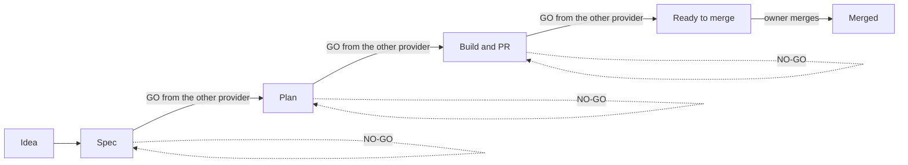

# relay-go

**Nothing merges without a GO.**

relay is a review pipeline for AI coding agents. Claude Code and Codex take turns: whatever one of them writes, the other reviews. A feature moves from idea to spec to plan to build, and each stage after the idea needs a GO from the other provider before it moves on. The owner (you) merges and releases. Agents never do. The command is `relay`.

## Why

Coding agents are fast and confident, and a model reviewing its own work tends to miss the same things twice. relay puts a second, different model in front of every stage, keeps the whole trail in git, and stops to ask you when the reviews stall instead of letting the agents go around in circles. You get the speed of agents with the checks a regulated team would expect: separation of duties, a recorded decision at every step, and a human merge.

## How a feature moves



- Every review ends in a GO or a NO-GO with findings. A NO-GO goes back to the author for another round.
- Reviews continue while they make progress, up to 4 rounds. If they stall, relay writes a summary of the open findings and waits for your decision: accept the stage, allow another round, or narrow the work.
- Small changes (`--small`) go straight to the build stage. They still get a cross-provider review.
- Every stage, review and owner decision is a file under `docs/relay/<feature>/` and a commit, so the history explains itself.

## What it looks like

`relay status` lists every feature across your projects. Rows marked `*` are waiting on you (example data):

```
  REPO     FEATURE         STAGE  STATUS          ROUND  OWNER   VERDICT
* webapp   login-timeout   build  ready-to-merge  2      claude  GO
    Merge PR #41 · waiting 20m
* api      rate-limits     plan   waiting-owner   4      codex   NO-GO
    Decide: plan review stopped. blocking findings rose (2 -> 3)
  mobile   offline-sync    spec   in-review       1      claude
```

A local dashboard (`relay ui`) shows the same inbox with a button for each decision, plus usage for both providers and the history of every feature. From a phone, a Claude session running the relay hub answers "what needs me?" and passes on "merge 41".

## Quick start

You need Python 3.11, git, the GitHub CLI (`gh`), and both Claude Code and Codex installed and logged in. relay uses your existing logins and stores no credentials.

    git clone https://github.com/MCrockett/relay-go.git && cd relay-go
    ./install.sh          # links the skills into Claude and Codex, and `relay` into ~/.local/bin

Opt a repo in by adding this line to its AGENTS.md:

    Follow <your relay checkout>/README.md.

Then, in that repo:

    relay new <slug>      start a feature: a branch, docs/relay/<slug>/, and you own it
    relay submit          hand in the current stage; the other provider reviews it
    relay status          what is waiting on you, across every project
    relay merge <pr>      merge a feature that has a fresh GO and passing tests

A Docker image with everything installed is described in the reference.

## Documentation

- **[docs/reference.md](docs/reference.md)**: the full manual. Agents working in a repo that follows this README read it for the rules of the loop, owner decisions, CI modes, merging and handoffs.
- **[docs/relay/](docs/relay/)**: relay is built with relay. Each folder there is one real feature of this project, with its idea, spec, plan, reviews and owner decisions. Some mention the owner's other projects, where the problems were first seen.
- `skills/` holds the agent skills, `prompts/` the review prompts, `relaylib/` the code and `tests/` the test suite.

## Limits

- Built for one owner on one machine. There is no shared server.
- Reviews spend your Claude and Codex plan usage. `relay cost` and the dashboard show how much.
- A reviewer's GO is advice, not proof. You still read the PR before you merge.
- Notifications and the menu bar are macOS only. Everything else is plain Python and git, and the tests run on Linux in CI.

## License

MIT. See [LICENSE](LICENSE).
